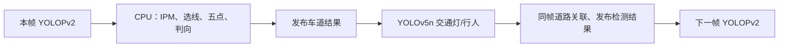
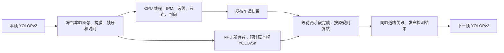

# 交通灯筛选回退、CPU/NPU 重叠及后续优化方案

本轮在 `better@059ba0b` 上继续，使用 E 盘代码。没有更换正式 RKNN，没有改 FPGA、SFC、摄像头引脚、DMA 等待、车道判向阈值或刹停状态机。IMU 和车辆控制保持关闭，S 的已验证显示配置保留。

## 一、交通灯按本次要求回退

`M/pcie/csrc/traffic_detector.cpp` 撤销了“另一类别分数高于交通灯类别，就排除交通灯候选”的比较。交通灯继续使用 class 9 的 objectness×class score，再做原有大小、位置、灯壳、颜色、冲突、跟踪和时效检查。原有三圆灯结构定位也保留。

行人 class 0 的类别竞争与阈值没有跟着删除。单次新鲜、合格的交通灯颜色立即生效，重复帧与旧帧依然不能作为新识别。这里改变的是用户指定的交通灯候选准入，不是把其他筛选或失效保护全部撤销。

`test_signal_competition.cpp` 使用真实解码器和假 RKNN 张量，覆盖 INT8/float、NCHW/NHWC；强竞争类别不再排除灯，交通灯分数不足仍被拒绝，行人结果不变。另检查候选预计算取消后裁剪调度状态可以恢复。

## 二、流水线怎样重叠

原路径：

新路径：

并行的是车道 CPU 后处理与小检测器工作。所有 `rknn_run` 仍在同一 NPU 所有者线程中按顺序执行；没有建立两个无约束的 NPU 推理线程，也没有改变模型输出属于哪一帧。

主要文件：

- `lane_cpu_stage.h`：常驻 CPU 线程，一个在途任务，没有不断增长的队列；异常通过 future 送回所有者。
- `latest_lane_worker.h`：图像、两张模型掩膜及计时先归入本帧任务；CPU 只处理该任务，下一次车道推理前必须完成 join。
- `traffic_service.cpp`：分为 `prepare_lane` 与 `after_lane`。前者只计算，后者在车道发布之后重新检查原 admission，再关联道路并发布。
- `traffic_detector.h/.cpp`：保存/恢复裁剪轮转、锁定视角和计时状态，供最终不合格的预计算取消使用。

正常启动默认启用；设置 `VISION_LANE_NPU_OVERLAP=0` 可以用同一二进制跑串行对照。M 的视频采集与画屏线程不等待 CPU 后处理。

### 为何多了最终检查

开始预计算时，CPU 还没有算完；此时不能把“可以尝试算”当作“允许发布”。CPU 完成后仍检查同一帧身份、实际年龄、车道有效性、耗时、预算和原有速率门控。

若最终不合格，丢掉预计算结果，恢复裁剪调度状态，既不发布行人/灯记录，也不更新“无人恢复”或其他控制状态。若早期条件不满足、最终满足，则走原同步检测回退路径，避免丢掉本来可以运行的检测。

### 保持的刹停规则

- 行人图像和绿色道路掩膜来自同一张校正后的前视图，不拿新行人框套旧道路掩膜。
- 路内、路外、不确定、道路掩膜失效、截断框等分类规则不变。
- Auto Brake 开关、前进/后退仲裁、绿灯加三次独立无危险观察恢复许可不变。
- 重复数据包不能计作多次无人，重发不能给旧结果续期。
- STOP 仍人工 REARM；红色刹停阴影仍只读原控制状态。

## 三、怎样验证

新增 `test-lane-overlap`：证明 CPU 与可选 NPU 阶段实际重叠、单一 NPU 所有者、输出缓冲区被模拟复用时快照仍正确、先发布车道再提交检测、CPU 异常、可选阶段异常及停止时取消。

新增 `test-service-overlap`：在独立 IPC namespace 内用真实服务和假 RKNN 张量检查，预计算期间行人记录不发布；过期和超预算不发布；一次接受只跑一次检测；原速率门控、帧号不符时回退、行人脚部与道路关系不变。不会操作真实 FSPI。

`lane_overlap_replay.cpp`：停止正式采集后，用真实 YOLOPv2 与 YOLOv5n、保存的 11 帧原始道路拼图，在每帧自己的径向/IPM 配置下分别运行串行和重叠模式。逐项比较：

1. 模型车道及道路掩膜逐字节一致。
2. IPM 五点、左右边界线型、拟合判向及角度一致。
3. 行人 flags、框、风险/路外/不确定计数、道路像素数及帧号对应一致。
4. worker、模型和映射器销毁后，保留的快照仍能正确恢复完整掩膜。

11/11 通过；保存的红、绿、黄、空白完整交通灯服务回放通过。它们是有限场景回归，不是覆盖所有道路的准确率证明。工具只在私有 IPC 中运行。

## 四、本轮板上性能

采用同一二进制、同一正式模型，按“关重叠—开重叠—关重叠”进行 A/B/A；每段预热 12 秒后采样 75 秒。不能用视频 FPS 代替新识别次数。

| 同一新版二进制 | 关重叠 A | 开重叠 | 关重叠 B |
|---|---:|---:|---:|
| M 视频 FPS | 30.003 | 30.003 | 30.001 |
| 新车道结果 Hz | 4.295 | 4.450 | 4.284 |
| 交通灯/前方行人检测 Hz | 4.296 | 4.461 | 4.292 |
| 车道 `rknn_run` ms | 197.55 | 197.04 | 196.89 |
| CPU 车道后处理 ms | 9.27 | 10.55 | 9.65 |
| 小检测器完整任务 ms | 12.21 | 13.05 | 12.61 |

以两次串行均值为基准，重叠的车道新结果频率提高约 **3.74%**，周期约从 233.1 ms 降到 224.7 ms。CPU/NPU 同时访问内存会令各阶段单项耗时略增，因此不能直接把原 CPU 的全部 9～10 ms 当作净节省。

必须同时报告另一个比较：最初旧进程 65 秒采样是 **4.448 Hz**，当时车道 `rknn_run` 为 **189.91 ms**。最终新版与该旧进程的总 Hz 接近，不能宣称端到端比原在线版本已经稳定提高 3.74%。A/B/A 说明在同一新版、相近模型运行时间下，重叠确实回收了一部分等待；旧/新进程的 NPU 耗时漂移抵消了该收益。需要更长时间、相同温度/负载的交叉测量，才能确认整机净收益。

两板最终同时运行 150 秒：

| 指标 | 结果 |
|---|---:|
| M 视频平均 / 最低五秒窗口 FPS | 29.998 / 29.95 |
| M 新车道结果 Hz | 4.453，约每 224.6 ms 一次 |
| M 交通灯/前方行人完整任务 Hz | 4.449 |
| S 显示平均 / 最低五秒窗口 FPS | 29.881 / 28.88 |
| S 接收 M 视频平均 FPS | 29.933 |
| S 每窗口 P99 帧间隔的最大值 | 53.73 ms |
| M 60 秒末行探针 | 1802 次采样，`read_errors=0 tail_bad_frames=0 checker_frames=0` |
| 两板工作线程失败、结果超时 | 均未记录到 |

这些五秒统计窗口没有掉到 22～23 FPS；不是逐个瞬间都达到 30 FPS 的承诺。S 显示已接近 30 帧，本轮不修改其二进制。网络发送日志约 30 FPS、`failed=0`。两板均无 swap，M/S 可用内存约 1297/1234 MiB，IMU/车辆控制维持关闭。

另将 11 帧的几何与线型直接对比改动前保存的 FP16 基线：方向、置信度、角度及左右线型 **11/11 一致**。S 的 `test-front-person`、`test-lane-rule`、`test-traffic-go` 通过，包含 Auto Brake、路内/路外/不确定、三次独立无人恢复、过期/重复和独立红灯保护；没有触发真实 FSPI。

### 部署与复现记录

- M 正式程序 SHA-256：`4c7df676548c2252a2411ff12da2921653cfeee1a63e4ba8254092dd24c844b7`。
- 正式 YOLOPv2 FP16 SHA-256：`4f0e9eb2c0eeb36ff9107803417ee57943939d2cb0b76edfc722773045674499`。
- 正式 YOLOv5n SHA-256：`38b08fb0875a00de86928f1591634fd6b209d9739fdcc8399b75fe151d6752da`。
- M 板 `/userdata/codex-overlap-20261110/` 保存构建、A/B/A、真实回放、部署哈希及最终采样。
- 本机 `output/cpu-overlap-20261110/{M,S}-evidence.tar.gz` 保存验证日志与发布清单；未把模型、私有画面或临时输出提交到 Git。
- 正常启动默认重叠；需要串行对照时，在启动同一 M 程序前设置 `VISION_LANE_NPU_OVERLAP=0`。这不会改变正式模型、判向公式或 S 刹停状态机。回退程序与源码也保存在 M 板本轮目录的 `OVERLAP-rollback-*` 中。

## 五、后续按收益和风险排序

| 优先级 | 工作 | 目的 | 是否改变识别行为 |
|---|---|---|---|
| 1 | 消除新快照中的重复掩膜复制 | 减少 CPU 与内存访问 | 以逐字节一致为准 |
| 2 | 校正图像在同一帧内复用 | 省掉重复径向映射 | 先验证映射、颜色和裁剪完全相同 |
| 3 | 增加动态回放、结果年龄和控制延迟量测 | 找到真正影响反应速度的位置 | 不改变 |
| 4 | 建立独立标注集，定向混合精度 | 降低约 190～200 ms 的模型计算 | 模型输出会变化，必须另验 |
| 5 | 小模型充分训练/蒸馏，再考虑 QAT | 争取明显提高识别次数 | 模型输出会变化，必须另验 |
| 6 | 道路成对选线、实虚线与交通灯难例 | 提高几何成功率和识别准确率 | 是，单独开关与验收 |
| 7 | S 小检测模型及三路布局对照 | 提高后向人员新结果频率 | 不能牺牲远处/遮挡人员召回 |
| 8 | SDK、驱动和可靠 DMA 完成机制 | 改善剩余计算、搬运开销 | 最后做，完整回归 |

### 1. 先减少重复工作，不再重复已否决的试验

本轮为并发显式复制模型输出，随后发布快照还可能复制一次。下一小步可以让 CPU 阶段和最终快照共享同一份拥有所有权的只读掩膜；需要在发布前完成全部写入，保留 `Snapshot::masks()` 的线程安全和保存快照的生命周期。收益预计较小，必须测完整周期，而不只测 memcpy。

前视校正也可能在视频与推理路径重复执行。只有当同一帧、同一 LUT、同一裁剪/缩放和 BGR/RGB 约定都一致时，才复用校正结果；必须在画任何标记之前取得副本。不能用画屏后的红绿叠加像素送模型，不能借用已经被下一帧覆盖的显示缓冲区。

单位缩放 letterbox 复制、共用逐行点集、直接掩膜 IPM、原生 FP16 输出等已经存在，不应重新包装成尚未完成的新优化。上一轮原生输入内存接口只是把转换时间挪入 `rknn_run`、总耗时没有下降；在布局没有新的变化前不优先重做。官方内存接口仍要求正确处理张量格式、步长和缓存，而不是调用一次就自动变快：[RKNN 原生内存示例](https://github.com/airockchip/rknn-toolkit2/blob/master/rknpu2/examples/rknn_api_demo/src/rknn_create_mem_demo.cpp)。

### 2. 测识别反应，不只看屏幕

每个新结果同时保存采集、NPU 完成、CPU 完成、发出、S 接收及显示提交时间；跨板时间比较前先校时或用往返测量，不能直接相减两块板各自的 monotonic 值。持续报告新结果 Hz、结果年龄、P95/P99、丢弃原因和发送等待。

用现有保存画面建立可重复序列：连续左右弯、实虚线切换、三色灯变化、路内/路外行人、遮挡、红白闪警、单路/六路切换。识别输入必须是没有 UI 叠加的校正图；线型证据仍用对应俯视图和覆盖掩膜。动态 UI 的 CPU 回放通过，不等于完整 X11/NPU/网络动态负载都经过了同样测试。

### 3. 想明显超过每秒约五次，仍要减少模型计算

在 `rknn_run` 仍约 190 ms 时，仅该项理想上限就约 `1000/190=5.26` 次/秒，实际还要给小检测器和输入输出留时间。流水线能够收回等待，但不能把此模型直接变成每秒十次。

下一轮模型工作应先建立代表性校准集与独立人工标注测试集，按场景/视频划分，不能把同一手机画面的相邻帧拆到训练和测试中。重点标注：细车道、阴影、反光、急弯、道路边界脚部、远处行人、非交通灯红色物体。

保留当前 FP16 基线，按逐层单层/累计误差选择混合精度保留层；输出端再转 float 不能恢复量化损失。评价除掩膜 IoU，还必须包含边界选择成功率、方向/角度、实虚线、误判绿灯、真实路内脚部被判路外等任务指标。上一轮 135 ms 候选仍有一个模拟脚部类别变化；需要人工真值判断它究竟是改善还是退化，不能只凭速度直接替换。

TwinLiteNet+ 提供道路/车道双分割和不同规模，任务匹配，但 RK3568 上实际速度必须测；既有候选与 600 步蒸馏没有达到本系统的完整回归要求。后续要充分训练、验证薄线和道路边缘，不能把 2 步 QAT 或几百步小样本蒸馏当作正式完成：[作者实现](https://github.com/chequanghuy/TwinLiteNetPlus)。

QAT 下一步是用可训练网络和真实标注完成训练，并检查导出模型的实际算子精度/落点。保留版本匹配的 Toolkit、Runtime、驱动、ONNX、输入预处理与 RKNN 哈希；SDK 升级先在隔离环境比较，不能在正式系统上直接覆盖 `librknnrt.so`：[Rockchip 官方 Toolkit2](https://github.com/airockchip/rknn-toolkit2)。

### 4. 选线和线型准确率单独优化

当前以候选近端点在 x=160 两边选左右边界；道路整体偏到一侧时，可能两条真实边界都在同侧。更好的选法是找共同围住同一可行驶区域的一对边界，检查共同 Y 范围、同一近端参考行的宽度、交叉和道路支持；最终五中点仍只表达道路方向，不额外加入车道居中控制。

跨虚线间隔可以建立几何关联，但插值点不能算成真实油漆。线型判断沿俯视标线方向累计可见油漆与间隔，区分真实路面空隙、遮挡、阴影及 IPM 无覆盖区。UNKNOWN 应保留明确原因，不能为了让它消失就强行输出实线或虚线。本轮没有改变用户指定的单次线型确认与低曲率 30° 门控。

### 5. 交通灯和行人

本轮按用户要求撤回交通灯的其他类别竞争排除。后续应针对实际误报记录：class 9 分数、候选位置、灯壳证据、圆灯结构、颜色分数和拒绝原因，用困难负例定位哪一关失败。可以训练专用信号灯检测器或对现有小模型微调；保持先目标/结构、再颜色的分工。不要把整个检测输入裁成上半幅而漏掉下方行人。

M 前方行人与道路目前同帧。不能为了提高行人 Hz，直接让新行人框套旧道路掩膜；优先提高道路模型速度。若将来做独立调度或运动补偿，必须重新验证边界脚部的路内/路外/不确定分类及保护策略，作为另一项行为变更验收。

S 仍保留 YOLOv5s640。YOLOv5n640 和更频繁提交确实有测速候选，但远小行人、遮挡和三路边缘的独立召回测试未充分完成。先保持相同输入和布局比较 s/n，再比较“三路单独 320”和“拼接 640”，避免同时改模型、尺寸、解码与布局。显示框去重和 3D 人物限额可以独立优化，不能据此截断制动所用的行人候选。

### 6. 标定、显示和 DMA

当前径向校正较简化。后续用多位置、压平标定板求内参、径向/切向参数和重投影误差；道路 IPM 必须对应真实行驶地面上的已知点，显示屏照片平面与真实路面标定要分开。地图预计算可继续保留，不需要每帧求矩阵。[OpenCV 标定](https://docs.opencv.org/4.x/dc/dbb/tutorial_py_calibration.html)、[平面单应变换](https://docs.opencv.org/4.x/d9/dab/tutorial_homography.html)。

S 正常关闭 Xfce 合成器的配置已经使显示接近 30 帧。后续重点是热插拔后完成事件回退的恢复与高负载长尾，不是盲目重新开 GLES、改 RGA 或关 DSI；这些路径已有无收益或回退记录。显示长尾与识别结果 Hz 要分别报告。

DMA 驱动必须有可靠完成条件后才考虑批处理或合并 ioctl。M 10 µs、S 8 µs 的现有保护和 `camera_valid_rows.h` 不得为提速随意缩短。最终须再测多路边界、末行闪点、停止/重启和错行；本轮没有触碰这些保护。

### 7. 不应当作捷径的改动

NPU 预算从 60 调到 80 ms 已测无收益；更高时钟在当前固件支持列表内也无余量。延长结果 TTL 只会掩盖旧结果，不能提高识别速度。

也不能直接启用 `RKNN_FLAG_ASYNC_MASK` 再沿用当前帧号：官方 API 说明该模式获取的可能是上一帧结果，需显式配对。本轮采用自己的有界任务和同帧快照，没有启用这个标志：[官方 API 定义](https://github.com/airockchip/rknn_model_zoo/blob/main/3rdparty/rknpu2/include/rknn_api.h)。

最后保留每次发布的代码提交、程序/模型/标定哈希、环境开关、相机映射、显示配置和实测摘要。日志存 userdata 并限额；旧模型文件是否存在和是否正在占 CPU/NPU 是两件事，不能把删除文件当作推理提速。
